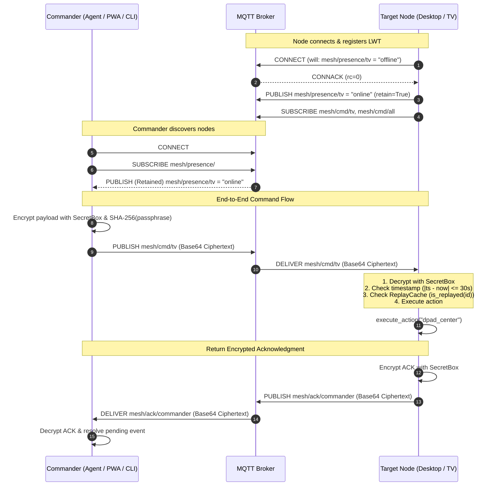

# CommandMesh MQTT Wire Protocol

This document defines the MQTT topic structure, JSON payload schemas, and lifecycle conventions used by all CommandMesh components.

---

## 1. MQTT Topic Hierarchy

All topics are prefixed with `mesh/` to isolate mesh communications from other services sharing the broker.

| Topic Pattern | Direction | Retained | Description |
|---------------|-----------|----------|-------------|
| `mesh/cmd/<node_id>` | Commander $\rightarrow$ Target Node | `False` | Point-to-point encrypted command dispatched to a specific node. |
| `mesh/cmd/all` | Commander $\rightarrow$ All Nodes | `False` | Broadcast encrypted command received by all online nodes in the mesh. |
| `mesh/ack/<sender_node_id>` | Target Node $\rightarrow$ Commander | `False` | Encrypted execution result/acknowledgment routed directly to the requester. |
| `mesh/presence/<node_id>` | Node $\leftrightarrow$ Broker | `True` | Plain JSON state packet indicating online/offline presence and node capabilities. |

---

## 2. Payload Schemas (Decrypted Payloads)

### A. Command Payload (`mesh/cmd/<target>` or `mesh/cmd/all`)

Before encryption, the commander formats a compact JSON string with the following fields:

```json
{
  "from": "agent_lapis",
  "to": "living_room_tv",
  "action": "dpad_center",
  "data": null,
  "ts": 1794659100,
  "id": "cmd_1794659100123_4567"
}
```

#### Field Specifications:
- `from` (`string`, required): Identifier of the originating node, agent, or controller.
- `to` (`string`, required): Target device ID, or `"all"` for broadcast.
- `action` (`string`, required): Command verb to execute (e.g., `vol_up`, `dpad_center`, `open_url`).
- `data` (`any`, optional): Action arguments (e.g., URL string, script name, key name, text to type).
- `ts` (`integer`, required): Unix timestamp in seconds. Used for $\pm 30$ second freshness validation.
- `id` (`string`, required): Unique message identifier (e.g., `cmd_<timestamp_ms>_<random_int>`).

---

### B. Acknowledgment (ACK) Payload (`mesh/ack/<sender_id>`)

Upon execution, the recipient encrypts and publishes an acknowledgment:

```json
{
  "from": "living_room_tv",
  "to": "agent_lapis",
  "in_reply_to": "cmd_1794659100123_4567",
  "action": "dpad_center",
  "status": "success",
  "output": "D-Pad Center Clicked",
  "ts": 1794659101,
  "id": "ack_1794659101456_8901"
}
```

#### Field Specifications:
- `from` (`string`, required): Identifier of the executing node.
- `to` (`string`, required): Identifier of the commander awaiting the result.
- `in_reply_to` (`string`, required): Corresponds directly to the `id` of the triggering command.
- `action` (`string`, required): Echo of the action executed.
- `status` (`string`, required): `"success"` if the action succeeded; `"error"` if it failed.
- `output` (`string`, required): Descriptive execution result or error explanation.
- `ts` (`integer`, required): Unix timestamp in seconds.
- `id` (`string`, required): Unique identifier for the ACK packet.

---

### C. Presence Payload (`mesh/presence/<node_id>`)

Presence packets are published with `retain=True` as unencrypted, lightweight JSON metadata so commanders can discover online devices immediately upon connecting.

#### Online State:
```json
{
  "id": "living_room_tv",
  "name": "Living Room Android TV",
  "type": "tv",
  "status": "online",
  "capabilities": [
    "dpad_up", "dpad_down", "dpad_left", "dpad_right", "dpad_center",
    "vol_up", "vol_down", "play_pause", "type_text", "open_url",
    "open_youtube", "home", "lock_device"
  ],
  "ts": 1794659090
}
```

#### Offline State (LWT):
Configured during MQTT client initialization via `client.will_set()`:
```json
{
  "id": "living_room_tv",
  "status": "offline",
  "ts": 1794659090
}
```

---

## 3. Complete Message Lifecycle


